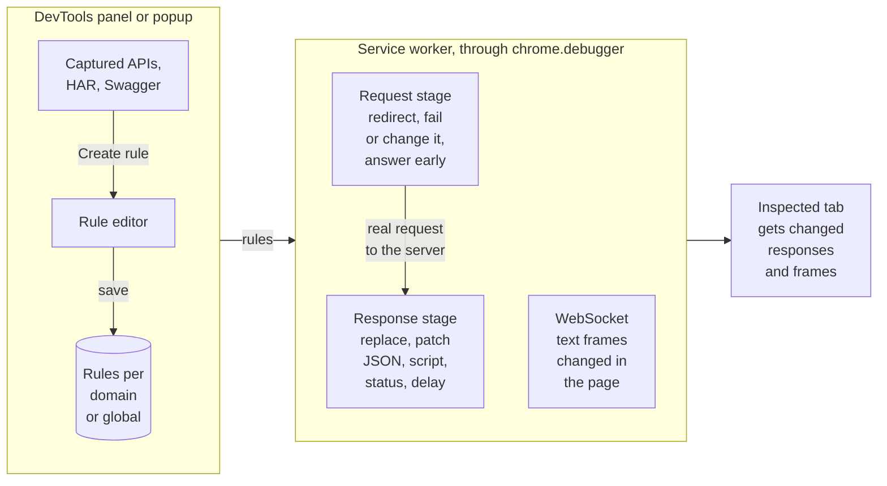
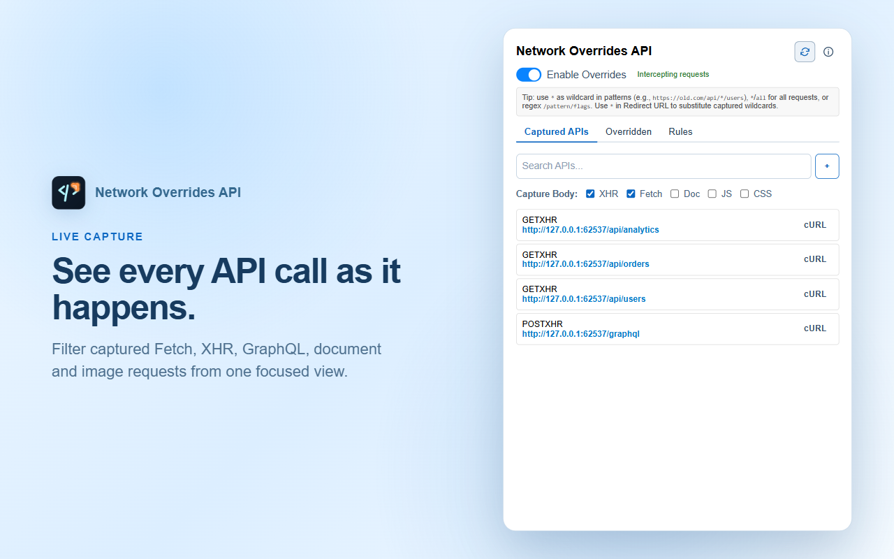
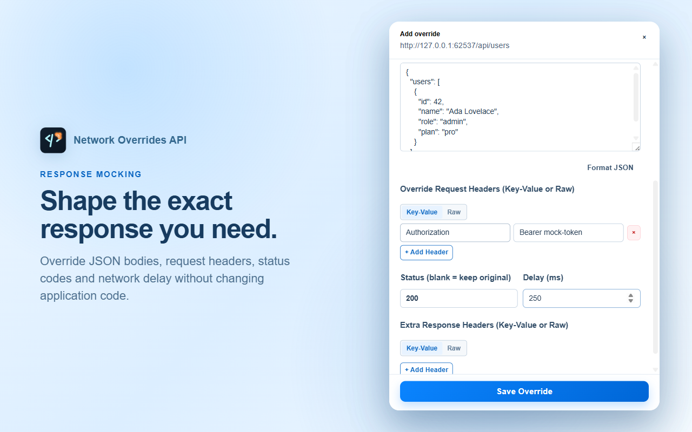
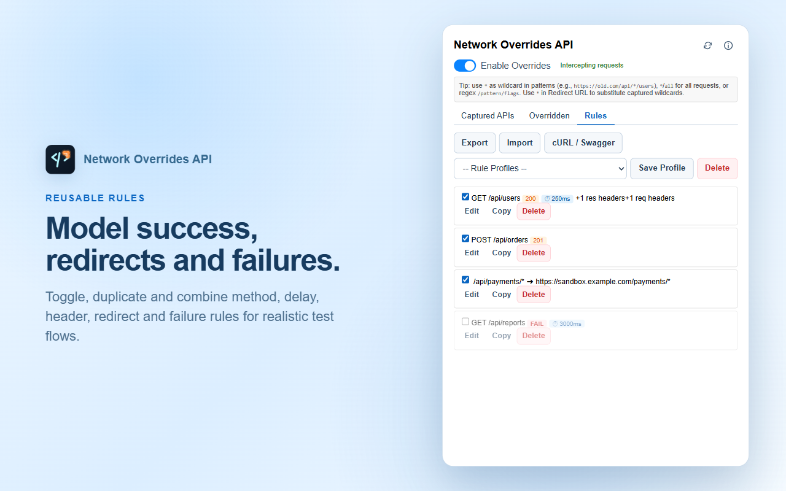
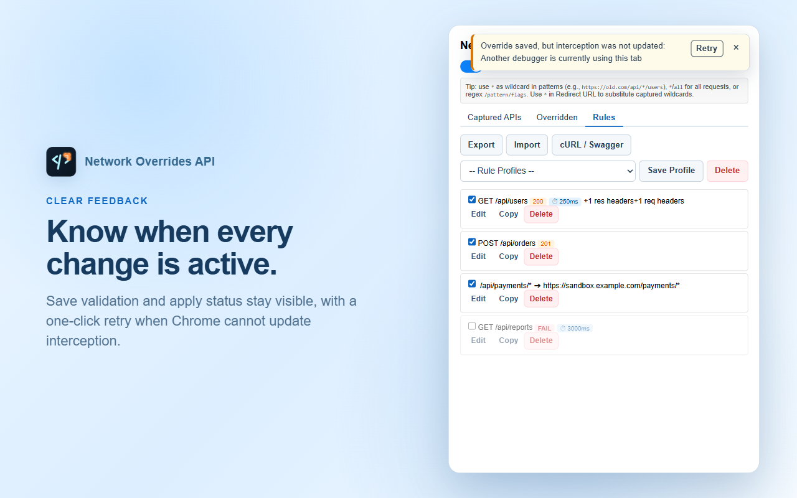

# Network Overrides DevTools

[](https://chromewebstore.google.com/detail/network-overrides-api-dev/holdjgmcnpelgclhopiejilhhkfcmpba)
[](https://vannt-dev.github.io/official.html)

A Chrome/Edge DevTools extension that changes network traffic while you debug. A rule matches requests by URL (substring, `*` glob or regular expression), optionally narrowed to one HTTP method, GraphQL operation, query parameter, request header or request body text, and then replaces the response, changes some fields of the real JSON response, redirects the request, fails it, or rewrites WebSocket frames. It uses `chrome.debugger` and the Chrome DevTools Protocol (Fetch domain) to pause requests and apply the first rule that matches.



### Compared with DevTools Local Overrides

Chrome's built-in [Local Overrides](https://developer.chrome.com/docs/devtools/overrides) serve a local file in place of a response and change response headers. This extension also does the following:

- **Patch the real response**: keep what the server sends and change only some JSON fields, with no code: `set data.user.plan = "pro"`, `remove data.ads`, `set data.items[0].price = 0`. Local Overrides serve a saved copy instead, which goes stale as the real data changes. See [Patch the real JSON response](#patch-the-real-json-response).
- **Status and per-rule delay**: a body rule can set the response status (100–599) and hold the response for up to 120 s, for that rule's requests only.
- **Request changes**: add or overwrite request headers, replace the request payload, or redirect the request to another URL before it is sent.
- **Narrower matching**: limit a rule to one HTTP method, one GraphQL `operationName`, given query parameters, request headers or a text in the request body, or match URLs with a regular expression.
- **Computed responses and WebSocket frames**: a script rule builds the response in JavaScript from the request and the real response; WebSocket rules replace, substitute, block or delay text frames.

🛒 **Chrome Web Store**: [Network Overrides API (DevTools)](https://chromewebstore.google.com/detail/network-overrides-api-dev/holdjgmcnpelgclhopiejilhhkfcmpba)

Official builds are listed at [vannt-dev.github.io/official.html](https://vannt-dev.github.io/official.html);
anything else is not published by vannt-dev.

## Screenshots

| Live API capture                                           | Override editor                                                |
| ---------------------------------------------------------- | -------------------------------------------------------------- |
|  |  |

| Reusable override rules                                      | Save and apply feedback                                               |
| ------------------------------------------------------------ | --------------------------------------------------------------------- |
|  |  |

- **Real-time API Type & Tab Counters**: Live request counters next to each resource filter (`XHR (5)`, `Fetch (12)`, `Doc (1)`, `JS (3)`, `CSS (0)`) and in tab headers (`Captured APIs (15)`, `Overridden (3)`, `Rules (2)`).
- **High-Performance LRU Regex & Batch DOM Rendering**: LRU-cached `RegExp` pattern matching (`regexCache`) and `DocumentFragment` batch DOM rendering to handle heavy network traffic without UI lag.
- **JS Bundling & Minimal Dist Packaging**: Build pipeline automatically concatenates scripts into 5 clean JS bundles (`background.bundle.js`, `ui.bundle.js`, `panel.js`, `popup.js`, `devtools.js`) and cleans unbundled source files for optimal store uploads.
- **Modern Minimalist Vector Branding**: Sleek vector icons with 3 customizable design variants stored in `icons/concepts/`.
- **Persistent MV3 Worker Rehydration & Port Retries**: Automatic tab state rehydration from `chrome.storage.session` and automatic 150ms message port retries to handle Chrome background worker sleep/wake cycles gracefully.
- **Enable/disable** overrides per active tab via a toggle switch.
- **Per-rule enable/disable toggle**: disable an individual rule without deleting it; it stays visible (dimmed) and is skipped by the background worker until re-enabled.
- **HTTP method matching**: scope a rule to `GET`/`POST`/`PUT`/`PATCH`/`DELETE`, or leave it at `Any` to match every method (default, pre-filled from the captured request when available).
- **Import/export rules as JSON**: back up or share the current domain's rules as a downloadable file, and load them back in with a merge-or-replace choice.
- **Rule Profiles & Presets**: save and load named rule presets per domain to switch quickly between different testing scenarios.
- **Duplicate Rules**: 1-click clone any override rule directly in the rules list.
- **Request Headers & Response Headers Overriding**: inject or modify request headers (e.g. `Authorization: Bearer token`) during the request stage or extra response headers during the response stage.
- **Response Image & Visual Preview**: instant image preview (Base64 PNG/JPG, SVG) directly inside the editor modal.
- **Dynamic Captured Resource Filters**: toggle body capture for XHR, Fetch, Document, Script, or Stylesheet resources with real-time counters.
- **Reorder rules**: drag a rule by its handle, or use the arrow keys on the handle, to change which rule wins when several match. Domain rules and global rules each keep their own order.
- **Three pattern matching modes** for override rules:
  - URL substring match (e.g. `/api/users`)
  - Wildcard `*` glob (e.g. `https://old.com/api/*/users` → `*` captures matching segments)
  - Regex `/pattern/flags` (e.g. `/api\/v1\/users\/\d+/i`)
  - `*` or `all` matches every request.
- **Four override types:**
  - **Mock response**: Replace the response body with custom text or raw base64 content, compute it with a script, or patch fields of the real JSON response.
  - **Redirect**: Redirect the request to a different URL (supports `*` wildcard substitution from captured groups).
  - **Network error**: Kill the request at the network layer with a chosen error reason — the page's `fetch`/XHR rejects as if the network failed.
  - **WebSocket frames**: rewrite, substitute (regex with `$1`), block or delay the text frames a page sends or receives on a real WebSocket. Pick "WebSocket" in the override dialog, or click a **WS** entry in the APIs tab. See [WebSocket frame rules](#websocket-frame-rules).
- **Status, headers, delay, and fail mocking**: a body rule can force the response status (100–599), add or overwrite response headers, and delay the response up to 120 s; a fail rule kills the request at the network layer (`Failed`, `TimedOut`, `ConnectionRefused`, `NameNotResolved`, `InternetDisconnected`).
- **View captured APIs**, grouped by resource type (XHR, Fetch, JS, CSS, Img, Doc, WS, etc.), with real-time updates from the background service worker.
- **Search APIs** by URL substring.
- **One-click override creation**: Click **Mock this** (or the row) on any captured API to open the editor filled from the real request: URL pattern, method, status and response body. The pattern stays editable, so you can widen it (for example `/api/users/42` to `/api/users/*`). When a rule already covers the request, its rule opens instead, so nothing is duplicated.
- **A short editor**: the editor shows only the URL pattern, method, type, status and response body. Everything else sits in a collapsed **Advanced** section, grouped as Conditions, Timing & failure, Response headers, Body type (patch & script) and Change the request. A group that holds a value opens by itself and shows how many settings it holds, so nothing is hidden silently.
- **One-click presets**: **Empty list** (status 200 with `[]`, or the real JSON with its lists emptied), **Server error** (500), **Slow (3 s)** (a 3000 ms delay) and **Offline** (a network error), filled into the editor's own fields.
- **One line per rule**: the Rules tab shows each rule as what it matches and what it does, for example `GET /api/orders + query page=2 → 500 · slow 3 s` or `ws wss://example.com/socket → replace frames`. Click it for the full editor.
- **Dynamic Response Templating**: Insert dynamic placeholders into mock responses (`{{$uuid}}`, `{{$isoDate}}`, `{{$epoch}}`, `{{$randomEmail}}`, `{{$randomName}}`, `{{$randomInt(min, max)}}`, `{{$query(paramName)}}`).
- **Per-rule hit counter**: every rule in the Rules tab shows how many times it was applied in this session (`0` greyed, a number highlighted), with the time and URL of the last one in its tooltip, so you can tell at a glance whether a rule is being applied at all. **Reset counts** starts over. The counts live in the session only and are never saved, exported or imported with the rules.
- **Global Cross-Domain Rules**: Scope rules globally across all domains (`isGlobal`), highlighted with a `GLOBAL` badge in the rules list.
- **Request Payload Interception & Modification**: Modify outgoing request payloads (`postData`) during the CDP request stage.
- **HAR File Import**: Paste or choose a `.har` file (HTTP Archive) under **Import → cURL or OpenAPI / Swagger…** to generate mock rules in bulk.
- **HAR File Export**: The **HAR** button next to the search box saves every request captured for the tab as a HAR 1.2 file: method, URL, request headers and payload, status, and the response body where one was captured. Response headers and timings are not recorded by the capture, so they are left empty. The file can be imported again to turn the capture into mock rules.
- **Traffic Analytics**: Track total overridden and failed request statistics per active tab.
- **Network Throttling Presets**: Apply No throttling, Fast 3G, Slow 3G, or Offline conditions to the active tab through the Chrome DevTools Protocol.
- **Editor Keyboard Shortcuts**: Modal hotkeys `Ctrl+Enter` / `Cmd+Enter` to save and `Ctrl+Shift+F` / `Cmd+Shift+F` to format JSON.
- **Auto-fill response body**: When creating a new override, the current response body is automatically fetched from the background worker and pre-filled into the editor.
- **JSON formatting**: Auto-detect and format JSON bodies with a single button.
- **Copy cURL**: Copy any API request as a cURL command.
- **Manual rule editor** (DevTools panel only): Quickly add a rule without opening the modal.
- **Persistent storage**: All rules, profiles, and settings survive browser restarts via `chrome.storage.local`.

## Architecture

```
src/
├── background.ts            # Service Worker entrypoint bootstrap
├── devtools.ts              # Chrome DevTools extension tab registration
├── panel.ts                 # DevTools panel entrypoint & HAR streaming
├── popup.ts                 # Action popup entrypoint
├── ui.ts                    # Shared UI state & controller orchestration
├── shared.ts                # Shared OverrideRule, ApiEntry, and header types
├── tab-state.ts             # Per-tab state store, session persistence, & worker rehydration
├── utils.ts                 # Pattern matching, wildcard, dynamic templates, LRU regex cache, & origin helpers
├── background/
│   ├── api-capture.ts       # CDP Network event listener & API tracking
│   ├── debugger-controller.ts # chrome.debugger attach/detach & domain setup
│   ├── encoding.ts          # Base64 response body encoding helpers
│   ├── interceptor.ts       # Fetch.requestPaused request/response/fail interceptor
│   ├── message-router.ts    # Background message listener & route handler
│   ├── response-script.ts   # Runs Script (JavaScript) rules in the inspected page
│   └── websocket-bridge.ts  # Installs the WebSocket wrapper and sends it the frame rules
├── injected/
│   └── websocket-wrapper.ts # In-page WebSocket wrapper that applies frame rules
└── ui/
    ├── api-list.ts          # Render captured APIs & resource type counters
    ├── attach-status.ts     # Status badge renderer (green/red)
    ├── curl.ts              # cURL command generator & parser
    ├── dialogs.ts           # Prompt & confirmation modal dialogs
    ├── har.ts               # HAR (HTTP Archive) parser and exporter
    ├── headers-editor.ts    # Request & Response headers editor table/textarea
    ├── modal-controller.ts  # Override editor modal event handlers
    ├── modal.ts             # Override modal UI state & visibility
    ├── notifications.ts     # Toast notifications (success/warning/error)
    ├── persistence.ts       # Storage persistence queue & error handler
    ├── primitives.ts        # UI element creation primitives
    ├── profiles.ts          # Per-domain rule profiles & presets
    ├── rules-io-controller.ts # Import/export JSON rules & HAR/Swagger drag-and-drop
    ├── rules-list.ts        # Render saved rules list with action buttons & badges
    ├── swagger.ts          # Swagger / OpenAPI spec parser
    ├── toolbar-controller.ts# Enable toggle, search, refresh, tabs, & action buttons
    ├── types.ts             # UI state & elements interfaces
    ├── view-utils.ts        # Highlighting & label formatting helpers
    └── websocket-rule.ts    # WebSocket frame rule fields in the override modal

styles.css                   # CSS stylesheet entrypoint
styles/                      # Modular CSS stylesheets (base, feature, modal/rules, primitive, guide)
scripts/                     # Automation scripts:
├── bundle.mjs               # Bundles TypeScript outputs into 5 clean JS files & cleans dist/
├── package-store.mjs        # Store zip packager
├── smoke.mjs                # Real Chromium Playwright integration smoke test
├── e2e-websocket.mjs        # Manual end-to-end check of WebSocket frame rules in Chromium
└── capture-store-screenshots.mjs # Store assets screenshot generator

icons/                       # Active extension icons (16x16, 48x48, 128x128)
icons/concepts/              # 3 concept icon design variants (concept-1, concept-2, concept-3)
dist/                        # Bundled JavaScript outputs (background.bundle.js, ui.bundle.js, panel.js, popup.js, devtools.js)
devtools.html                # DevTools tab registrar page
panel.html                   # DevTools panel page
popup.html                   # Extension action popup page
guide.html                   # Bundled offline user guide
manifest.json                # Chrome Manifest V3 configuration
```

### Key flows

1. **Initialization**: `devtools.ts` creates a DevTools panel → `panel.ts` fires up UI + listens to `chrome.devtools.network` events (HAR + `onRequestFinished`). Popup uses `popup.ts` instead, without HAR or manual editor.

2. **Debugger attachment**: When "Enable Overrides" is checked, `background.ts` calls `chrome.debugger.attach` on the active tab, enables `Network`, applies the selected throttling preset, and enables `Fetch` for both Request and Response stages. Detachment happens on disable, tab close, or debugger disconnect.

3. **Request interception** (`Fetch.requestPaused`):
   - **Request stage**: Checks override rules in precedence order. A rule with `failReason` kills the request via `Fetch.failRequest` (after `delayMs`, if set). Otherwise a rule with `redirectUrl` redirects via `Fetch.continueRequest` with a modified URL — wildcards (`*`) in the redirect URL are substituted with captured groups from the pattern match. A body rule with `respondAtRequest` is answered here with `Fetch.fulfillRequest`, so the request is never sent.
   - **Response stage**: Checks override rules for a body replacement. If found, `Fetch.fulfillRequest` sends the custom body (base64-encoded) with the original status and headers — unless the rule overrides them via `statusCode`/`responseHeaders` (same-name headers overwritten case-insensitively) — plus the `x-network-overrides: true` and `x-network-overrides-pattern` markers, delayed by `delayMs` if set. If no rule matches, XHR/Fetch response bodies are stored for later auto-fill via `Fetch.getResponseBody`.

4. **Recent API tracking**: `Network.requestWillBeSent` captures request metadata into an in-memory Map (per tabId), mirrored to `chrome.storage.session` under key `tabState_{tabId}` (debounced). Capped at 500 URLs and 100 bodies. On worker startup, this state is rehydrated from `chrome.storage.session` and the debugger is re-attached to tabs that were enabled; any legacy `recentApis_{tabId}` / `recentApiBodies_{tabId}` keys left over from older versions in `chrome.storage.local` are removed automatically.

5. **UI state**: `enabled`, per-domain rules (`overrides_{origin}`), global rules (`overrides_global`), and `apiSearchTerm` are persisted in `chrome.storage.local` and survive across DevTools sessions and browser restarts. Domain-specific rules take precedence over global rules.

## Storage

Rule and UI state is stored in `chrome.storage.local` (permanent); per-tab runtime state is stored in `chrome.storage.session` (cleared when the browser exits):

| Key                  | Type                                                                      | Persistence                                                                                             |
| -------------------- | ------------------------------------------------------------------------- | ------------------------------------------------------------------------------------------------------- |
| `enabled`            | `boolean`                                                                 | Permanent — survives browser restart                                                                    |
| `overrides_{origin}` | `OverrideRule[]` (rules for one domain, e.g. `overrides_https://a.test`)  | Permanent — survives browser restart                                                                    |
| `overrides_global`   | `OverrideRule[]` shared across every domain                               | Permanent — survives browser restart                                                                    |
| `apiSearchTerm`      | `string`                                                                  | Permanent — survives browser restart                                                                    |
| `tabState_{tabId}`   | per-tab snapshot (`enabled`, `origin`, `overrides`, captured APIs/bodies) | `chrome.storage.session` — cleared when the browser exits; rehydrated and re-attached on worker startup |

**Important**: Override rules are never lost. Recent API data is keyed by `tabId`, lives only for the current browser session, and is only visible when the same tab is active. Legacy keys from older extension versions are migrated automatically: a flat `overrides` list is moved to the current domain's `overrides_{origin}` key on UI load, and `recentApis_{tabId}` / `recentApiBodies_{tabId}` keys are removed from `chrome.storage.local` on worker startup.

## WebSocket frame rules

A WebSocket rule matches the socket URL (`wss://api.example.com/*`), the direction (send, receive or both) and optionally the frame text (contains, or a regular expression). The first enabled rule that fits is applied:

| Action     | Effect                                                                     |
| ---------- | -------------------------------------------------------------------------- |
| Replace    | The frame becomes the body (templates such as `{{now}}` work).             |
| Substitute | Every match is replaced by the body; `$1`… refer to regex groups.          |
| Block      | The frame is dropped.                                                      |
| Delay      | The frame waits the given milliseconds; frames behind it keep their order. |

Limits: only text frames are changed (binary frames pass untouched); sockets opened from Web Workers or cross-origin iframes are not covered; frames the page receives after a rule has changed them are dispatched by the extension, so their `event.isTrusted` is `false`. Reload the page after adding the first WebSocket rule if the socket was already open.

The wrapper is installed through the debugger session the extension already holds (`Page.addScriptToEvaluateOnNewDocument` and `Runtime.evaluate`), so it needs no extra permission. Turning interception off empties the rules in the page. If the debugger is detached another way (the "Cancel" button on Chrome's debugging bar, or DevTools taking over the tab), the page keeps its last rules until it reloads or interception is turned on again. Rule changes reach iframes that are already open only after they reload.

## Patch the real JSON response

A body rule whose mode is **Patch the real JSON response** (`"mode": "patch"`) lets the request reach the server and changes only the fields you list in its JSON response. The rest of the data stays live, so the rule does not go stale the way a saved copy of the response does. In the editor, write one change per line:

```text
set data.user.plan = "pro"
remove data.ads
set data.items[0].price = 0
set data.items[-] = {"id": 99}
```

- `set <path> = <value>`: the value is JSON (text in double quotes). `remove <path>` deletes a field or an array item.
- Paths use dots and `[n]` (`data.items[0].name`), quoted keys for keys with dots, spaces or `=` (`data["user.name"]`), or a JSON Pointer when they start with `/` (`/data/items/0/name`). `[-]`, or `-` in a JSON Pointer, is the end of an array.
- A `set` creates the objects its path is missing (an array when the next part is `[n]` or `[-]`). A `remove` of a missing path does nothing.

The operations are saved, exported and imported as a `patch` list:

```json
{
  "pattern": "/api/me",
  "mode": "patch",
  "body": "",
  "patch": [
    { "op": "set", "path": "data.user.plan", "value": "pro" },
    { "op": "remove", "path": "/data/ads" }
  ]
}
```

The real status and headers are kept, except that the body is re-sent without its old `Content-Length` and `Content-Encoding`; the rule's own Status, Response headers and delay still apply. The JSON goes back compact. Templates are not processed in patch values, and a patch rule never answers without calling the server.

A response that is not JSON or has no body (HTML, `204`, a redirect) passes through unchanged, and the panel shows a warning naming the rule; an operation that cannot apply (a path through a string, an index past the end of an array) is skipped and named in the same warning, while the others apply. Warnings for one rule are shown at most every 10 s. Patch rules run in the extension's worker, not in the page, so unlike [script responses](#script-responses) they need no JavaScript, and an imported patch rule cannot run code.

## Script responses

A body rule whose mode is **Script (JavaScript)** computes its response instead of holding one. The rule's body is the body of an async function that receives `request` and returns the response:

```js
// Keep the real response, but only its first three items.
const data = JSON.parse(request.response.body);
return { status: 200, body: { ...data, items: data.items.slice(0, 3) } };
```

`request` holds `url`, `method`, `headers` (names in lower case), `query` (the first value of each parameter), `params` (what each `*` of the pattern matched), `body` (the request payload, or `null`) and `response`: the original `status`, `headers` and `body` (`null` when it has none, such as a redirect).

| Returned value                            | Response                                                                                          |
| ----------------------------------------- | ------------------------------------------------------------------------------------------------- |
| a string                                  | That string as the body.                                                                          |
| `{ status, headers, body }` (any of them) | `body` as it is when a string, as JSON otherwise; `headers` is a `{ name: value }` object.        |
| any other object, array, number, boolean  | The value as JSON. To send JSON with a top-level `body` key of its own, wrap it: `{ body: {…} }`. |

A status or header the script returns wins over the rule's own Status and Response headers; the rule's delay still applies. Templates such as `{{now}}` are not processed in a script.

The script runs in the inspected page, through the debugger session the extension already holds (`Runtime.evaluate`), so it can use `fetch`, `localStorage` and the page's own globals, and it needs no extra permission. It is given 5 seconds. A script that throws, returns nothing, returns a status outside 100–599, or runs out of time does not fall back to the real response: the request is answered with status `500`, the error as its text and the header `x-network-overrides-error: script`.

Limits: the request stays paused while the script runs; a script on a request made by a Web Worker or a cross-origin iframe still runs in the top page; a binary original response reaches the script as garbled text. Rules imported from a file may contain scripts, which run in the pages they match — import only files you trust, as with any rule that replaces a page's JavaScript.

## Pattern Reference

Override rules are evaluated in order; the first matching rule for a URL is used. Domain rules come before global rules; within each group the order is the one shown in the Rules tab, which you can change by dragging.

| Pattern                       | Matches                                                      |
| ----------------------------- | ------------------------------------------------------------ |
| `/api/users`                  | Any URL containing `/api/users`                              |
| `*` or `all`                  | Every request                                                |
| `https://site.com/api/*/list` | URLs matching the glob; `*` captures zero or more characters |
| `/\/api\/v\d+\/users/`        | Regex match (literal `/` delimiters, no flags)               |
| `/\/api\/user\/(\d+)/gi`      | Regex with flags `g` and `i`                                 |

In redirect URLs, `*` substitutes captured wildcards in order. For example:

- Pattern: `https://old.com/api/*/item/*`
- Redirect: `https://new.com/api/*/product/*`
- Request URL: `https://old.com/api/v2/item/5`
- Redirected to: `https://new.com/api/v2/product/5`

### Rule fields

Optional fields on an override rule:

| Field              | Type                        | Description                                                                                           |
| ------------------ | --------------------------- | ----------------------------------------------------------------------------------------------------- |
| `statusCode`       | optional integer 100–599    | Forces the mocked response status (body rules only).                                                  |
| `responseHeaders`  | optional `{name, value}[]`  | Added to the mocked response; same-name headers are overwritten case-insensitively (body rules only). |
| `delayMs`          | optional number 0–120000    | Delays the response/failure by N ms (body and fail rules).                                            |
| `failReason`       | optional enum               | Makes the rule fail the request at the network layer instead of answering.                            |
| `respondAtRequest` | optional boolean            | Body rules: answer before the request is sent, so the server is never called (see below).             |
| `patch`            | `{op, path, value?}[]`      | With `"mode": "patch"`: changes applied to the real JSON response (see above).                        |
| `graphqlOperation` | optional string             | Applies the rule only to the GraphQL operation with this `operationName` (see below).                 |
| `matchQuery`       | optional `{name, value?}[]` | Applies the rule only when every query parameter is present (and equal, when `value` is given).       |
| `matchHeaders`     | optional `{name, value?}[]` | Applies the rule only when every request header is present (and equal); names ignore case.            |
| `matchBody`        | optional string             | Applies the rule only when the request body contains this text.                                       |

### Answer without calling the server

A body rule normally answers at the response stage: the request reaches the server first, and its response is replaced. With **Answer without calling the server** (`respondAtRequest: true`, under **Advanced → Timing & failure**) the rule is fulfilled at the request stage with `Fetch.fulfillRequest`, so the server is never contacted: no side effects on `POST`, and unreachable hosts or endpoints that do not exist yet still get the mock.

The response is built from the rule alone: a blank status means `200`, and the headers are the rule's own (plus the CORS headers below). Templates work (they read the request, not the response); a script sees `request.response` as `{ status: null, headers: {}, body: null }`. Cross-origin requests work with no extra headers: the CORS preflight is answered for you, and the mock allows the page's origin unless the rule sets its own `Access-Control-Allow-*` headers.

### GraphQL operation

`graphqlOperation` narrows a rule to one GraphQL operation sent to a shared URL such as `/graphql`. It matches when the JSON request body's `operationName` equals the value (case-insensitive), failing that when its `query` contains the value, failing that when the raw body contains it. Requests without a body do not match.

### Query, header and body conditions

`matchQuery`, `matchHeaders` and `matchBody` narrow a rule further. Each one you set must hold, together with the pattern, method and GraphQL operation; a rule without them matches exactly as before. In the editor they sit under **Advanced → Conditions**.

- **Query parameters** (`page=2&debug`): a name with a value needs one of that parameter's values to equal it, after URL decoding; a name alone needs the parameter to be present with any value. Names are case-sensitive.
- **Request headers** (one `Name: value` or `Name` per line): names ignore case, values must be equal.
- **Request body contains**: the request body must contain the text (case-sensitive). When the browser does not hand the body to the extension, for example a streamed upload, the condition does not match.

A CORS preflight carries neither the request's headers nor its body, so only the query conditions decide whether a rule answering without the server also answers the preflight.

```json
{
  "pattern": "/api/orders",
  "mode": "text",
  "body": "{\"items\":[]}",
  "matchQuery": [{ "name": "page", "value": "2" }, { "name": "debug" }],
  "matchHeaders": [{ "name": "X-Tenant", "value": "acme" }],
  "matchBody": "\"plan\":\"pro\""
}
```

Rule files exported before these fields existed import unchanged.

## Usage

### 1. Open the extension UI

Two entry points:

- **Popup**: Click the extension icon in the toolbar. Shows "Captured APIs", "Overridden", and "Rules" tabs.
- **DevTools panel**: Open DevTools (F12) → "Overrides" tab. Same UI plus a manual rule editor row at the top of the "Rules" tab.

The UI is in English and Vietnamese (Tiếng Việt). It follows the browser's language; the
language menu beside the Enable Overrides switch changes it to English or Tiếng Việt, and **Auto** goes back to
the browser's language. The choice is saved in `chrome.storage.local`, and both languages ship
inside the extension (`_locales/`), so switching needs no network.

### 2. Enable overrides

Toggle **Enable Overrides** on. The extension attaches the debugger to the current tab.

Use the **Network** selector to apply a Fast 3G, Slow 3G, or Offline preset. The live counters beside it show how many requests were overridden or failed in the active tab.

### 3. Capture APIs

Browse your application as normal. Requests appear in the **Captured APIs** tab, grouped by resource type (XHR, Fetch, JS, CSS, etc.). Use the search bar to filter by URL.

### 4. Create an override

Click **Mock this** on any API in the list (or the row itself) to open the editor, filled from the real request. You can also click **+** to start from an empty rule, or add a rule manually (DevTools panel only) by filling in the pattern, body, and clicking "Add override".

The editor shows the everyday fields first:

- **Presets**: **Empty list**, **Server error**, **Slow (3 s)** and **Offline** fill the fields below in one click.
- **URL pattern** and **Method**.
- The type of rule:
  - **Mock response**: answer with a **Status code** (blank keeps the real one) and a **Response body**. The **Format JSON** action appears when the body contains valid JSON.
  - **Redirect**: Enter the target URL. Use `*` to substitute wildcards captured from the pattern match.
  - **Network error**: the request fails at the network layer instead of receiving a response. Pick the error under **Advanced → Timing & failure → Simulate a network error** (`Failed`, `TimedOut`, `ConnectionRefused`, `NameNotResolved`, `InternetDisconnected`); the group opens when you choose this type.
  - **WebSocket**: Replace, substitute, block or delay the text frames sent or received on a socket whose URL matches. Clicking a **WS** entry opens this type directly. See [WebSocket frame rules](#websocket-frame-rules).

Everything else is under **Advanced**, in groups that stay closed until you need them:

- **Conditions**: GraphQL operation, query parameters, request headers, request body text, and **Apply on every site (global rule)**.
- **Timing & failure**: a **Delay** in milliseconds, the network error to simulate, and **Answer without calling the server**. Body and fail rules can use delay; combine `TimedOut` with a long delay to simulate a real timeout.
- **Response headers**: headers to add, in Key–Value or Raw mode.
- **Body type: patch & script**: `Text`, `Raw base64`, `Script (JavaScript)` or `Patch the real JSON response`, and whether `{{...}}` placeholders are filled in.
- **Change the request**: replace the request body, and add or replace request headers.

When you edit a rule, every group that holds a value opens and shows a count on its header.

### 5. Manage rules

Switch to the **Rules** tab to edit, copy, delete, or enable/disable saved rules. Each rule is one line: what it matches → what it does, such as `POST /graphql (op: GetUser) → patch 2 fields` or `/api/* → network error`; click it to open the editor. A disabled rule stays visible but dimmed and is skipped by the background worker. Use **Export** to save the current domain's rules and **Import** to load them back: the Import menu holds **Rules file (.json)** and **cURL or OpenAPI / Swagger…** (a cURL command, an OpenAPI / Swagger spec or a HAR file). A rules file import provides explicit **Append rules** and **Replace rules** choices when rules already exist; rule files exported by earlier versions import unchanged. The **Overridden** tab shows captured APIs currently matched by a rule; hover the **Overridden** badge to see that rule's summary.

### 6. Copy cURL

Each API entry has a "cURL" button that copies the request as a cURL command (method, headers, and post data included).

## Setup & Build

Requirements: Node.js 22.22.1+, Chrome or Edge.

```bash
npm install
npm run build
```

Load the extension:

1. Open `chrome://extensions` or `edge://extensions`
2. Enable **Developer mode**
3. Click **Load unpacked**
4. Select the project root (the folder containing `manifest.json`)

The `manifest.json` points to files in `dist/`, so re-run `npm run build` after any TypeScript changes.

## Scripts

```bash
npm run build          # Compile TypeScript → dist/
npm run lint           # ESLint over src/
npm test               # Build + run test suite
npm run coverage       # Build + run tests with coverage report
npm run ci:test        # CI pipeline (same as coverage)
npm run smoke          # Real-browser smoke test (loads the unpacked extension into Chromium)
npm run store:screenshots # Create versioned Store screenshots, promo tiles, and description note
npm run package:store  # Create a ZIP for Chrome Web Store / Edge Add-ons
```

## Development Standards

- **Formatting**: Prettier via lint-staged (pre-commit hook).
- **Commit messages**: Conventional Commits enforced by commitlint + Husky hooks.
- **Commit types**: `add`, `feat`, `fix`, `docs`, `style`, `refactor`, `perf`, `test`, `chore`, `ci`, `revert`, `build`.

## Testing

Tests live in `tests/` and cover:

- Pattern matching logic (`helpers.test.mjs`)
- UI behavior with DOM mocks (`ui-behavior.test.mjs`)
- Background debugger event handling (`background-flow.test.mjs`)
- Per-tab state store: session mirror, caps, dispose, rehydrate (`tab-state.test.mjs`)
- Entrypoint bootstrapping (`entrypoints.test.mjs`)

`npm run smoke` (`scripts/smoke.mjs`) additionally drives the real unpacked extension in Chromium via Playwright — attach status, interception, status override, network-layer fail, worker-restart recovery, cross-origin navigation, and attach failures. Run it before releases; it needs a display (headed browser) and downloads Chromium on first use.

`npm run store:screenshots` (`scripts/capture-store-screenshots.mjs`) loads the real extension with deterministic demo API data and recreates the four `1280x800` PNG files in `store-assets/screenshots/`. It also needs a headed Chromium session.

## CI

GitHub Actions (`.github/workflows/ci.yml`) installs dependencies, checks formatting with Prettier, lints commit messages with commitlint, runs tests with coverage, and uploads the coverage report as an artifact.

## Store Packaging

```bash
npm run package:store
```

Produces a ZIP in `release/` containing only the runtime files (`manifest.json`, `*.html`, `styles.css`, `dist/`, `icons/`) plus `privacy_policy.md`. `dist/` is cleaned and rebuilt first so stale compiled files never ship.

## Permissions

- `debugger` — required to intercept and modify network requests via Chrome DevTools Protocol.
- `storage` — required to persist override rules, settings, and recent API data.
- `host_permissions: <all_urls>` — required to attach the debugger to any tab.

## Limitations

- Overrides only apply to the tab currently attached to the debugger.
- Recent API data is capped at 500 URLs and 100 response bodies per tab.
- Recent API bodies are only stored for XHR and Fetch resource types by default. Tick more types (Doc, JS, CSS) in the capture filters of the APIs tab; the choice is saved (`capturedBodyTypes` in `chrome.storage.local`) and kept when the service worker restarts or the panel is opened again.
- Recent API lists are keyed by `tabId` and reset when the tab is closed and reopened.
- The extension is designed for developer debugging only, not for end-user production use.

## License

Distributed under the MIT License. See [LICENSE](LICENSE).
